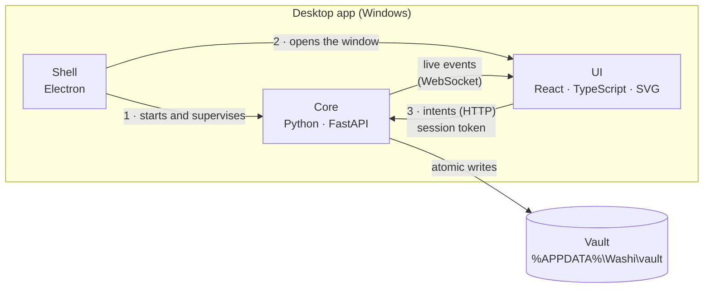
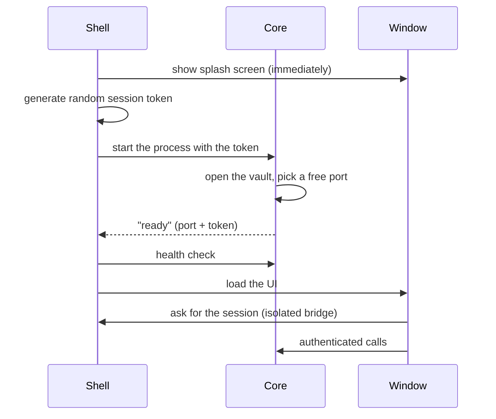
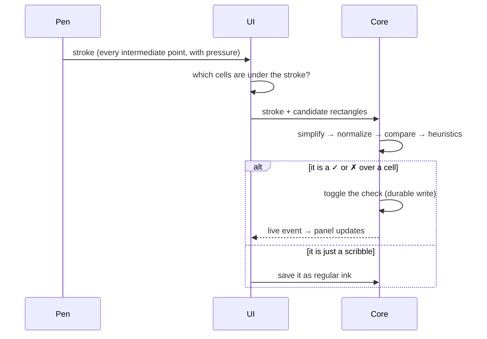

# Washi architecture

<sub><a href="README.en.md">← back</a> · <a href="ARQUITETURA.md">Português</a></sub>

How Washi is built on the inside: the pieces, how they talk, how data stays safe on
disk, and the choices (and trade-offs) behind each decision.

---

## 1. Three processes, one rule



**The project rule:** every business rule and every disk access lives in the Python core.
The UI only renders and sends intents ("check this cell", "move this widget"). That
gives a single source of truth, and the most critical part (data) sits in the easiest
layer to test.

| Process | Responsibility |
|---|---|
| **Shell (Electron)** | lifecycle: starts the core, checks it answered, opens the window, shows a readable error if anything fails, writes a diagnostic log |
| **Core (Python)** | rules for habits, kanban, canvas and search; validation of every input; persistence; gesture recognition; backups |
| **UI (React)** | infinite vector canvas, widgets, drawing tools, optimistic editing with undo |

### How the app starts



The splash screen comes first: on the first run the antivirus scans the executable and the
core may take a few seconds — without it, the app looked frozen.

---

## 2. Data: files you can read

No proprietary database. The vault is a regular folder, Obsidian-style:

```
vault/
├── boards/<board>/
│   ├── board.json          camera, name
│   ├── widgets.json        position and size of each widget
│   ├── elementos.json      shapes, text and arrows on the canvas
│   └── ink/
│       ├── layer-01.jsonl  one stroke per line (append-only)
│       └── erased.jsonl    eraser "tombstones"
├── todos/<task>/
│   ├── todo.md             YAML frontmatter + Markdown description
│   └── checkins.jsonl      check history (append-only)
├── kanbans/<board>/
│   ├── board.json          columns and WIP limits
│   └── cards/*.md          one card = one Markdown file
├── notes/*.md
└── .washi/                 config, operation journal, backups
```

A task, for example (fictional data):

```markdown
---
nome: Flexões
freq_dia: 2
modo: meta
alvo: { tipo: repeticoes, valor: 100 }
inicio: 2026-10-01
---
Two sets of 10.
```

Derived values — streaks, progress, projected finish date — are **never stored**: they
are recomputed from history, so there are never two "truths" that disagree.

Why files instead of a database: they are readable, outlive the app, fit in a plain
backup or a Git repository, and a diff shows exactly what changed. The price is that
queries become scans (search walks the vault); for one person's data that is instant,
and a disposable index would be the natural next step if it grew.

---

## 3. Integrity: the disk is never left half-written

Three mechanisms, each covering a different failure:

**Atomic writes** — editable files (JSON, Markdown) are never overwritten in place. A
temporary file is written next to the target, flushed to disk, and only then swapped in
with an atomic OS operation. A power cut leaves either the old file or the new one,
never a mix.

<sub>Code excerpt:</sub>

```python
def write_bytes(path: Path, data: bytes) -> None:
    """Replace only after flushing a unique temporary file beside the target."""
    fd, name = tempfile.mkstemp(prefix=f".{path.name}.", suffix=TMP_SUFFIX, dir=path.parent)
    tmp = Path(name)
    try:
        with os.fdopen(fd, "wb") as stream:
            stream.write(data)
            stream.flush()
            os.fsync(stream.fileno())
        os.replace(tmp, path)      # atomic on the same volume
        _fsync_dir(path.parent)
    finally:
        tmp.unlink(missing_ok=True)
```

**Append-only logs** — checks and strokes are appended to `.jsonl` files, one line per
record. If the app dies mid-line, that line has no trailing newline. Reading tells this
case apart (a record that was never committed → silently dropped) from garbage in the
middle of the file (real corruption → explicit error, nothing is hidden):

<sub>Simplified excerpt:</sub>

```python
for number, line in enumerate(lines, 1):
    if not line.strip():
        continue
    # Last line without "\n" = write interrupted by a crash. Never committed.
    if number == total and not line.endswith("\n"):
        continue
    try:
        record = json.loads(line)
    except ValueError as exc:
        raise VaultCorrompido(f"{file}: invalid JSON on line {number}") from exc
```

**Concurrency and backups** — every write to a vault goes through a lock (fast clicks or
two windows never duplicate a check). A journal records every operation, and a scheduler
zips the vault 5 minutes after launch and then every 12 hours, keeping the latest 10.

---

## 4. Checking a habit by drawing a ✓

The most "Washi" feature: you draw a ✓ with the pen over today's cell and it gets
checked — no clicking.



The recognizer is pure geometry, no machine-learning libraries:

1. **Filter** the points that fall on the cell (with a small margin — too large a margin
   made strokes "leak" into the neighbor on tight grids).
2. **Simplify** the stroke (Ramer–Douglas–Peucker) to at most 32 points.
3. **Normalize** to a standard box, removing size and position.
4. **Compare** against ✓, ✗ and circle templates (in the style of the *$1* recognizer).
5. **Heuristics**: number of vertices, angle, whether it closes on itself or crosses itself.
6. **Decide** with a confidence threshold; below it, the stroke becomes ink — a legitimate
   scribble is never swallowed.

If the core does not answer in time, the stroke also becomes ink: nothing you draw is lost.

---

## 5. The vector canvas

Everything on the canvas is SVG — strokes, shapes, text and arrows — so it stays crisp at
any zoom. Freehand strokes use *perfect-freehand*, the same technique as Excalidraw, which
turns pen points and pressure into a smooth outline.

**Arrows know what they are attached to.** Instead of storing only coordinates, each end
stores `{target, anchor}` — one of the four handles (north, east, south, west) of a shape
or widget. The position is recomputed at render time, so the arrow follows what you move.
If the target is deleted, the end is "released" at its last position instead of pointing
at nothing.

**Hit-testing by outline, not by interior.** A shape is only selected (or erased) near
its border. It sounds minor, but it is what lets you draw a rectangle around a widget to
group it without the rectangle stealing the widget's clicks.

**Dragging without redrawing the whole desk.** While a widget is dragged, its provisional
position flows through a lightweight channel that only the drawing layer listens to —
bound arrows follow in real time without re-rendering every panel on every pixel. The
core only receives the final position, on release.

---

## 6. Optimistic UI and undo

Every action shows up on screen **before** the disk confirms it. If the core rejects a
stroke, a widget move or a card move, the UI rolls back and shows why. Undo (Ctrl+Z)
uses the cheapest representation for each kind of data:

| Data | How it is undone |
|---|---|
| Shapes, text, arrows | snapshot of the previous set (it is small) |
| Drawn stroke | deletes the stroke by id |
| Erased stroke | removes the "tombstone" — the eraser never destroys the original stroke |

---

## 7. Security of a local app

Even offline, a local server is an open door on the machine. So:

- it listens **only** on the loopback address, never on the network;
- every session has a **random token**, required on every call and on the live connection;
- requests from other origins (another website open in the browser) are rejected;
- the window runs **isolated** (no system access), with a strict content policy and a
  two-function bridge to the shell;
- imported files have a size cap; ids are validated against path traversal.

---

## 8. How quality is verified

| Level | What it covers | Volume |
|---|---|---|
| Unit (core) | habit rules, persistence, crash recovery, recognizer, validation | 205 tests |
| Unit (UI) | geometry (eraser, anchors, outline, connector routes, lasso, selection), camera, grid, timeline scale, notices | 163 tests |
| Types and style | strict typing in Python and TypeScript, linting | every change |
| Integration | real server starting and answering over HTTP | end-to-end script |
| **Real browser** | a code-driven browser uses the UI like a person would | 270 checks |
| Packaged | the `.exe` itself is launched and used, with no dev tooling | per release |

The "real browser" level was added after a lesson: with every unit test green, the app
was broken for whoever used it.

| Symptom | Cause | Why unit tests missed it |
|---|---|---|
| widget buttons did nothing | the header captured the pointer for dragging, so the click never reached the button | the server was correct; the bug lived only in the interaction |
| shapes stopped moving after the first step | the browser started a native drag and cancelled the gesture | it only happens with a real pointer |
| pen ✓ never checked anything | the cell id had a character the server (rightly) rejected | tests used simple ids |
| nothing updated live | the server was missing its WebSocket library | no test opened a real live connection |

---

## 9. Conscious trade-offs

| Choice | Gain | Price |
|---|---|---|
| Python + Electron (instead of Tauri or web-only) | business rules in Python, easy to test; identical rendering on every machine | ~126 MB installer |
| Readable files (instead of a database) | portable, versionable data that survives the app | queries are scans |
| SVG (instead of a raw canvas) | crisp at any zoom; clickable elements; accessibility | per-stroke cost — mitigated by caching each stroke's outline |
| Fully local (no cloud) | full privacy, works offline | syncing across machines is up to the user (for now) |
| Geometric recognizer (instead of ML) | no dependencies, explainable, predictable | thresholds need manual tuning |

---

<sub>© 2026 Ares. Text and images on this page: all rights reserved.
Washi's source code is not public.</sub>
