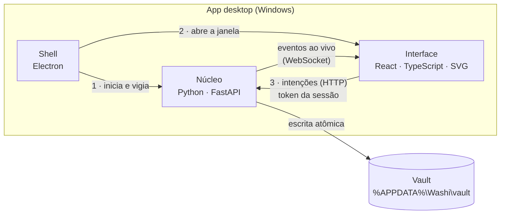
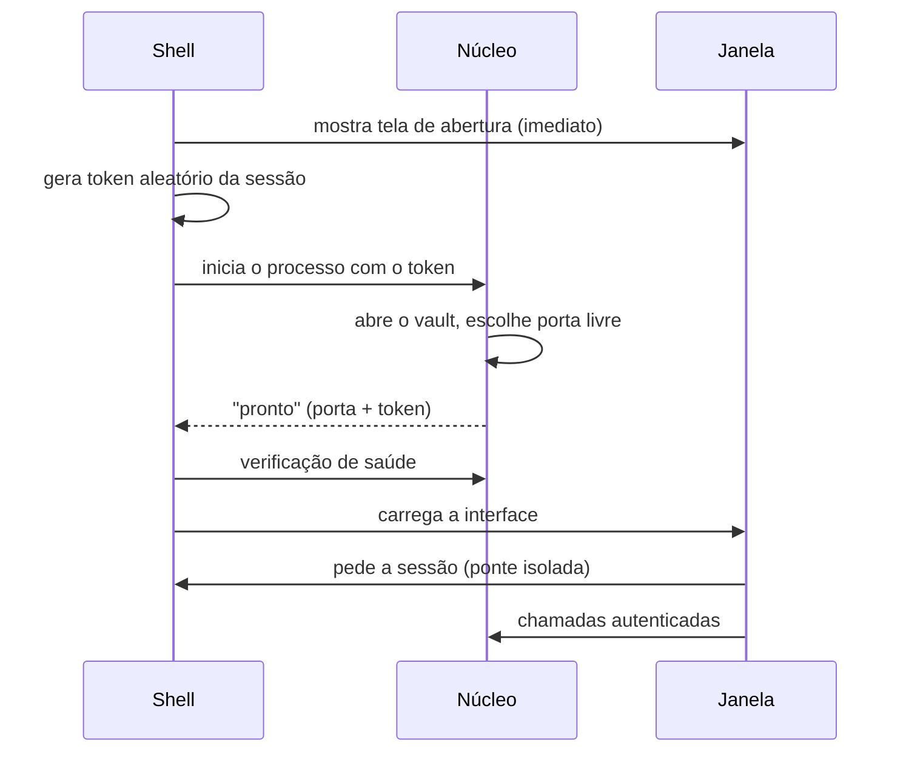
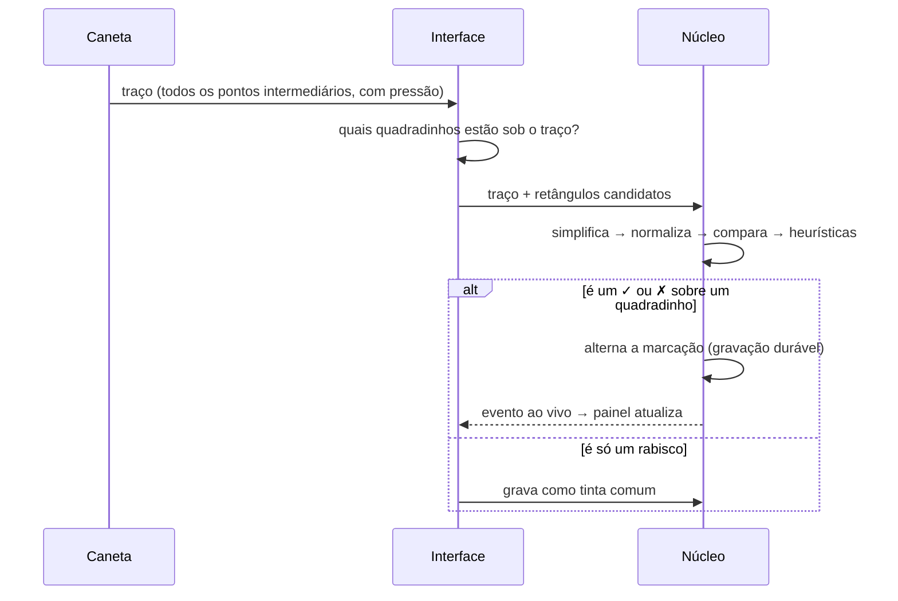

# Arquitetura do Washi

<sub><a href="README.md">← voltar</a> · <a href="ARCHITECTURE.en.md">English</a></sub>

Como o Washi é construído por dentro: as peças, como conversam, como os dados ficam
seguros no disco e as escolhas (e renúncias) por trás de cada decisão.

---

## 1. Três processos, uma regra



**A regra do projeto:** toda regra de negócio e todo acesso a disco vivem no núcleo
Python. A interface só desenha e envia intenções ("marcar este quadradinho", "mover
este widget"). Assim existe uma única fonte de verdade, e a parte mais crítica (dados)
fica na camada mais fácil de testar.

| Processo | Responsabilidade |
|---|---|
| **Shell (Electron)** | ciclo de vida: sobe o núcleo, confere que ele respondeu, abre a janela, mostra erro legível se algo falhar, grava log de diagnóstico |
| **Núcleo (Python)** | regras de hábitos, kanban, quadro e busca; validação de tudo que entra; persistência; reconhecimento de gestos; backups |
| **Interface (React)** | quadro infinito vetorial, widgets, ferramentas de desenho, edição otimista com desfazer |

### Como o app abre



A tela de abertura aparece antes de tudo: na primeira execução o antivírus inspeciona o
executável e o núcleo pode levar alguns segundos — sem ela, o app parecia travado.

---

## 2. Dados: arquivos que você consegue ler

Nada de banco proprietário. O vault é uma pasta comum, no estilo Obsidian:

```
vault/
├── boards/<mesa>/
│   ├── board.json          câmera, nome
│   ├── widgets.json        posição e tamanho de cada widget
│   ├── elementos.json      formas, textos e setas do quadro
│   └── ink/
│       ├── layer-01.jsonl  um traço por linha (só cresce)
│       └── erased.jsonl    "lápides" da borracha
├── todos/<tarefa>/
│   ├── todo.md             frontmatter YAML + descrição em Markdown
│   └── checkins.jsonl      histórico de marcações (só cresce)
├── kanbans/<quadro>/
│   ├── board.json          colunas e limites de trabalho
│   └── cards/*.md          um cartão = um arquivo Markdown
├── notes/*.md
└── .washi/                 config, diário de operações, backups
```

Uma tarefa, por exemplo (dados fictícios):

```markdown
---
nome: Flexões
freq_dia: 2
modo: meta
alvo: { tipo: repeticoes, valor: 100 }
inicio: 2026-10-01
---
Duas séries de 10.
```

Valores derivados — sequência, progresso, data prevista — **nunca são gravados**: são
recalculados a partir do histórico. Isso evita que dois números "da verdade" discordem.

Por que arquivos e não um banco: são legíveis, sobrevivem ao app, cabem num backup
comum ou num repositório Git, e um diff mostra exatamente o que mudou. O preço é que
consultas viram varreduras (a busca percorre o vault); para o volume de uma pessoa isso
é instantâneo, e um índice descartável seria o passo natural se crescesse.

---

## 3. Integridade: o disco nunca fica pela metade

Três mecanismos, cada um cobrindo uma falha diferente:

**Escrita atômica** — arquivos editáveis (JSON, Markdown) nunca são sobrescritos no
lugar. Grava-se um temporário ao lado, força-se a ida ao disco, e só então ele
substitui o original numa operação atômica do sistema. Uma queda de energia deixa o
arquivo antigo ou o novo, nunca um pedaço dos dois.

<sub>Trecho do código (comentários traduzidos):</sub>

```python
def write_bytes(path: Path, data: bytes) -> None:
    """Substitui só depois de gravar um temporário único ao lado do destino."""
    fd, name = tempfile.mkstemp(prefix=f".{path.name}.", suffix=TMP_SUFFIX, dir=path.parent)
    tmp = Path(name)
    try:
        with os.fdopen(fd, "wb") as stream:
            stream.write(data)
            stream.flush()
            os.fsync(stream.fileno())
        os.replace(tmp, path)      # atômico no mesmo volume
        _fsync_dir(path.parent)
    finally:
        tmp.unlink(missing_ok=True)
```

**Registros que só crescem** — marcações e traços são acrescentados ao fim de arquivos
`.jsonl`, uma linha por registro. Se o app cai no meio de uma linha, ela fica sem a
quebra final. A leitura distingue esse caso (registro nunca confirmado → descartado em
silêncio) de lixo no meio do arquivo (corrupção real → erro explícito, nada é escondido):

<sub>Trecho simplificado (nomes traduzidos):</sub>

```python
for numero, linha in enumerate(linhas, 1):
    if not linha.strip():
        continue
    # Última linha sem "\n" = gravação interrompida por queda. Nunca foi confirmada.
    if numero == total and not linha.endswith("\n"):
        continue
    try:
        registro = json.loads(linha)
    except ValueError as exc:
        raise VaultCorrompido(f"{arquivo}: JSON inválido na linha {numero}") from exc
```

**Concorrência e backups** — todas as escritas de um vault passam por uma trava
(cliques rápidos ou duas janelas não duplicam uma marcação). Um diário registra cada
operação, e um agendador gera um `.zip` do vault 5 minutos após abrir e depois a cada
12 horas, mantendo os 10 mais recentes.

---

## 4. Marcar um hábito desenhando um ✓

O recurso mais "Washi": você desenha um ✓ com a caneta sobre o quadradinho do dia, e ele
é marcado — sem clicar em nada.



O reconhecedor é geometria pura, sem bibliotecas de aprendizado de máquina:

1. **Filtrar** os pontos que caem no quadradinho (com uma margem pequena — margem
   grande demais fazia o traço "vazar" para o vizinho em grades apertadas).
2. **Simplificar** o traço (Ramer–Douglas–Peucker) para no máximo 32 pontos.
3. **Normalizar** para uma caixa padrão, removendo tamanho e posição.
4. **Comparar** com modelos de ✓, ✗ e círculo (no estilo do reconhecedor *$1*).
5. **Heurísticas**: número de vértices, ângulo, se fecha sobre si, se cruza a si mesmo.
6. **Decidir** com limiar de confiança; abaixo dele, o traço vira tinta — um rabisco
   legítimo nunca é engolido.

Se o núcleo não responder a tempo, o traço também vira tinta: nada que você desenha se
perde.

---

## 5. O quadro vetorial

Tudo no quadro é SVG — traços, formas, textos e setas — então fica nítido em qualquer
zoom. Os traços à mão usam *perfect-freehand*, a mesma técnica do Excalidraw, que
transforma os pontos e a pressão da caneta num contorno suave.

**Setas sabem a quem estão presas.** Em vez de guardar só coordenadas, cada ponta guarda
`{alvo, âncora}` — uma das quatro bolinhas (norte, leste, sul, oeste) de uma forma ou
widget. A posição é recalculada ao desenhar, por isso a seta acompanha o que você move.
Se o alvo for apagado, a ponta é "solta" na última posição em vez de apontar para o nada.

**Clique pelo contorno, não pelo miolo.** Uma forma só é selecionada (ou apagada pela
borracha) perto da sua borda. Parece detalhe, mas é o que permite desenhar um retângulo
em volta de um widget para agrupá-lo sem que o retângulo passe a roubar os cliques do
widget.

**Arrasto sem re-desenhar a mesa.** Ao arrastar um widget, a posição provisória circula
por um canal leve que só a camada de desenho escuta — as setas presas acompanham em
tempo real sem re-renderizar todos os painéis a cada pixel. O núcleo só recebe a
posição final, ao soltar.

---

## 6. Interface otimista e desfazer

Toda ação aparece na tela **antes** da confirmação do disco. Se o núcleo recusar um
traço, um movimento de widget ou de cartão, a interface volta ao estado anterior e mostra
o motivo. O desfazer (Ctrl+Z) usa a
representação mais barata para cada tipo de dado:

| Dado | Como desfaz |
|---|---|
| Formas, textos, setas | instantâneo do conjunto anterior (é pequeno) |
| Traço desenhado | apaga o traço pelo id |
| Traço apagado | remove a "lápide" — a borracha nunca destrói o traço original |

---

## 7. Segurança de um app local

Mesmo sem internet, um servidor local é uma porta aberta na máquina. Então:

- escuta **só** no endereço local, nunca na rede;
- cada sessão tem um **token aleatório**, exigido em toda chamada e na conexão ao vivo;
- requisições de outras origens (outro site aberto no navegador) são recusadas;
- a janela roda **isolada** (sem acesso ao sistema), com política de conteúdo restrita
  e uma ponte mínima de duas funções para o shell;
- arquivos importados têm limite de tamanho; ids são validados contra fuga de pasta.

---

## 8. Como a qualidade é verificada

| Nível | O que cobre | Volume |
|---|---|---|
| Unitário (núcleo) | regras de hábito, persistência, recuperação após queda, reconhecedor, validação | 182 testes |
| Unitário (interface) | geometria (borracha, âncoras, contorno, rotas dos conectores, laço), câmera, grade | 147 testes |
| Tipos e estilo | tipagem estrita no Python e no TypeScript, lint | a cada mudança |
| Integração | servidor real subindo e respondendo por HTTP | roteiro de ponta a ponta |
| **Navegador real** | um navegador controlado por código usa a interface como uma pessoa | 231 verificações |
| Empacotado | o próprio `.exe` é aberto e usado, sem ferramentas de desenvolvimento | por versão |

O nível "navegador real" foi acrescentado depois de uma lição: com todos os testes
unitários verdes, o app estava quebrado para quem usava.

| Sintoma | Causa | Por que os testes unitários não viram |
|---|---|---|
| botões do widget não respondiam | o cabeçalho capturava o ponteiro para o arrasto, e o clique nunca chegava ao botão | o servidor estava certo; o defeito era só na interação |
| forma parava de mover no 1º passo | o navegador iniciava um arrasto nativo e cancelava o gesto | só acontece com um ponteiro de verdade |
| ✓ com a caneta nunca marcava | o identificador do quadradinho tinha um caractere que o servidor (corretamente) recusava | os testes usavam identificadores simples |
| nada atualizava ao vivo | faltava a biblioteca de WebSocket no servidor | nenhum teste abria uma conexão ao vivo de verdade |

---

## 9. Renúncias conscientes

| Escolha | Ganho | Preço |
|---|---|---|
| Python + Electron (em vez de Tauri ou só web) | regras de negócio em Python, fáceis de testar; renderização idêntica em toda máquina | instalador de ~126 MB |
| Arquivos legíveis (em vez de banco) | dados portáveis, versionáveis, à prova de "app abandonado" | consultas por varredura |
| SVG (em vez de canvas puro) | nitidez em qualquer zoom; elementos clicáveis; acessibilidade | custo por traço — mitigado com cache do contorno de cada traço |
| Tudo local (sem nuvem) | privacidade total, funciona offline | sincronizar entre máquinas fica por conta do usuário (por enquanto) |
| Reconhecedor geométrico (em vez de ML) | sem dependências, explicável, previsível | precisa de calibração manual dos limiares |

---

<sub>© 2026 Ares. Texto e imagens desta página: todos os direitos reservados.
O código-fonte do Washi não é público.</sub>
