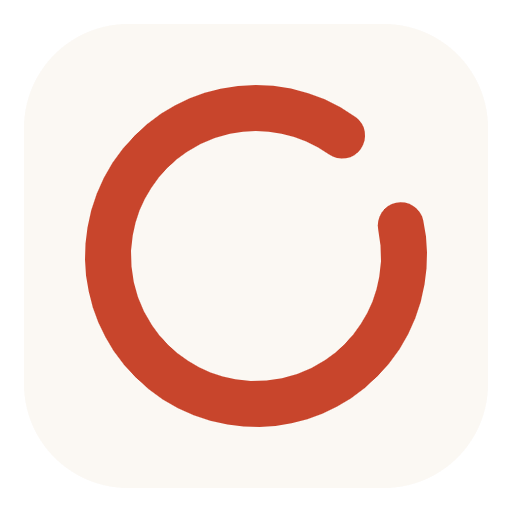
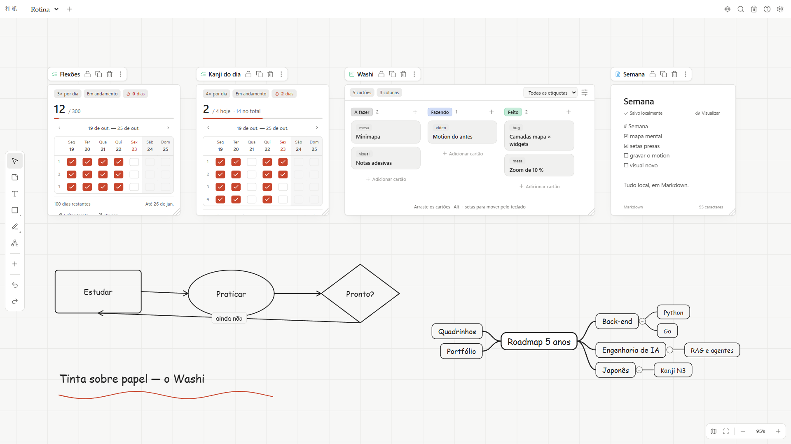
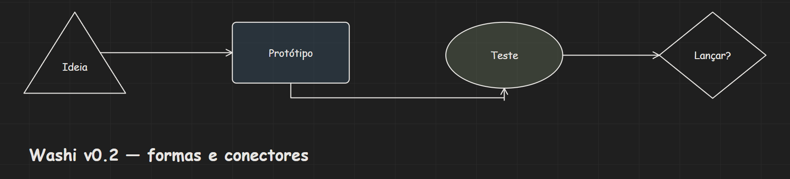
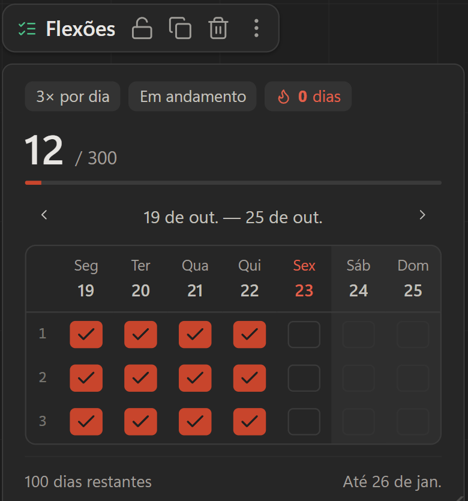
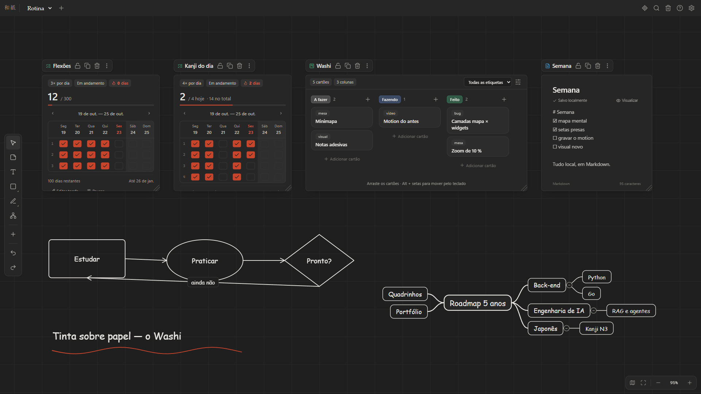
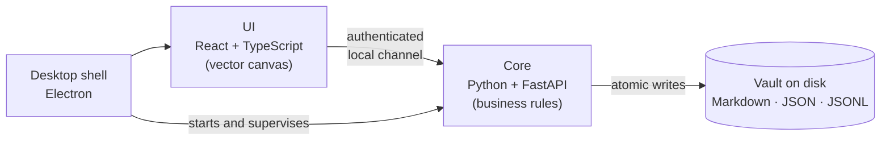

  

<h1 align="center">Washi 和紙</h1>

  <b>A local-first digital desk</b> — habits, kanban, notes and an infinite canvas
  for mouse or pen, all in one place and never leaving your computer.

  <a href="README.md">Português</a> ·
  <a href="ARCHITECTURE.en.md"><b>Architecture</b></a> ·
  Personal project · Windows · Source in a private repository

---

## Why

I wanted a single space to track daily habits, organize projects and sketch ideas —
like a real desk where the to-do list, the sticky-note board and the notebook sit side
by side. The tools I tried either split these into separate apps or kept my data in
someone else's cloud.

Washi puts everything on one infinite canvas, with the data stored as **plain files on
your own machine** (Markdown, JSON) — readable and yours.

## Features

| | |
|---|---|
| **Goal-based habits** | daily check grid, streaks, progress and projected finish date — "2× a day until 100" works out the schedule for you |
| **Check with a pen** | drawing a ✓ over a cell marks the habit — the stroke is recognized locally |
| **Kanban** | WIP limits, tags, drag and drop, keyboard support |
| **Notes** | Markdown with autosaved drafts |
| **Infinite canvas** | pressure-sensitive pen, highlighter, eraser, shapes, text and arrows that bind to elements and follow them |
| **Search** | finds anything across the whole vault |
| **Light and dark themes** | minimalist Japanese aesthetic (*ma*, *wabi-sabi*) |

  
  &nbsp;&nbsp;
  

## Engineering decisions

- **Truly local-first.** Nothing leaves the machine: no account, no remote server, no
  telemetry. Data lives in readable folders and files (Obsidian-style), easy to back up
  or version with Git.
- **Data integrity.** Atomic writes, an operation journal, recovery from files truncated
  by a power loss, and automatic rotating backups.
- **Two-layer architecture.** Business rules and disk access live in a Python core; the
  UI only renders and sends intents. They talk over an authenticated, loopback-only
  channel.
- **Vector canvas.** Everything on the board is vector, crisp at any zoom. Arrows store
  *what* they are attached to, not just coordinates — so they follow what you move.
- **Gesture recognition.** A geometric recognizer decides whether a stroke over a cell is
  a ✓, an ✗ or just a scribble, with tolerance for tightly packed grids.
- **Optimistic UI.** Moving, drawing and checking respond instantly; the disk confirms in
  the background, with undo (Ctrl+Z).

➡️ **[Architecture in depth](ARCHITECTURE.en.md)** — on-disk data format, how writes
survive power loss, the ✓ recognition step by step, security, and the trade-offs behind
each choice.

## Quality

| Layer | How it is verified |
|---|---|
| Core | 111 automated tests, strict typing, linting |
| UI | unit tests for geometry and camera, type checking |
| **Real usage** | 32 checks in a real browser: draws, erases, connects shapes, drags widgets, checks a habit with the pen and verifies screen + disk |
| Packaged | the installer is tested by launching the `.exe` itself, with no dev tooling |

Real-browser testing was the most valuable lesson of the project: it caught interaction
bugs (interrupted drags, buttons that never received the click, a gesture rejected by
the server) that sailed through every unit test.

## Stack

**Python 3.12** · FastAPI · Pydantic v2 · **TypeScript** · React 18 · Vite · SVG ·
perfect-freehand · **Electron** · PyInstaller · electron-builder · pytest · mypy ·
ruff · Vitest · Playwright

## Status

In personal use. Possible next steps: optional sync between machines, exporting the
board as an image, and tuning recognition with real pen data.

The source code is in a private repository — happy to walk through it in an interview.

## Contact

**Ares** · [LinkedIn](https://www.linkedin.com/in/aresd-dev) · [aresd.dev@gmail.com](mailto:aresd.dev@gmail.com)

© 2026 Ares. Images and text on this page: all rights reserved.
