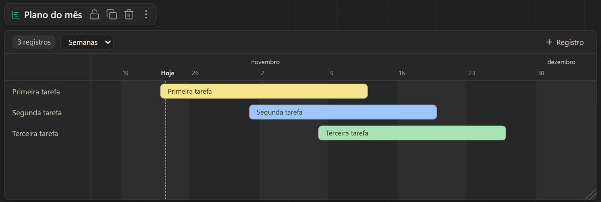
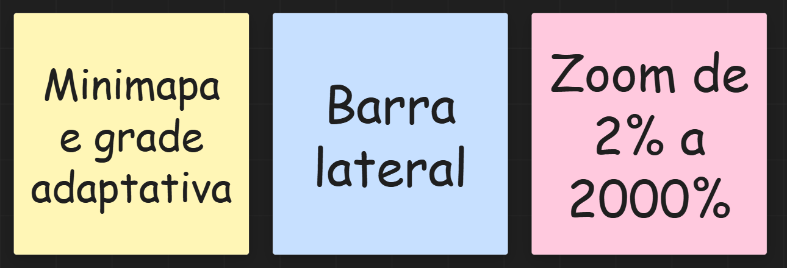
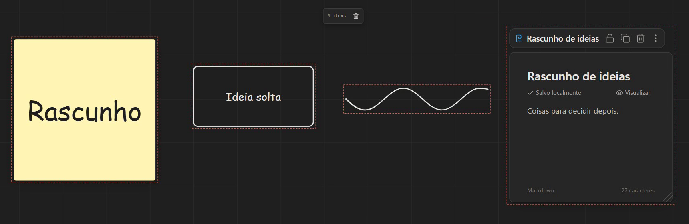
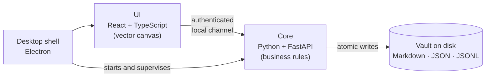

  

<h1 align="center">Washi 和紙</h1>

  <b>A local-first digital desk</b> — habits, kanban, notes and an infinite canvas
  for mouse or pen, all in one place and never leaving your computer.

  <a href="README.md">Português</a> ·
  <a href="ARCHITECTURE.en.md"><b>Architecture</b></a> ·
  Personal project · Windows · Source in a private repository

---

## Why

I wanted a single space to track daily habits, organize projects and sketch ideas —
like a real desk where the to-do list, the sticky-note board and the notebook sit side
by side. The tools I tried either split these into separate apps or kept my data in
someone else's cloud.

Washi puts everything on one infinite canvas, with the data stored as **plain files on
your own machine** (Markdown, JSON) — readable and yours.

## Features

| | |
|---|---|
| **Goal-based habits** | the week as a table, streaks, progress and projected finish date — "2× a day until 100" works out the schedule for you. Big goals group up: at most 5 cells a day, each worth 5, 10, 15… |
| **Check with a pen** | drawing a ✓ over a cell marks the habit — the stroke is recognized locally |
| **Kanban** | colored column labels, WIP limits, tags, drag and drop, keyboard support |
| **Timeline** | records with a start and an end on a weeks or months scale; drag a bar to move its dates, pull an edge to stretch it |
| **Notes** | a document page with a title, Markdown with autosaved drafts and task lists (☐) |
| **Sticky notes** | 16 colors; text auto-fits the note and turns light on dark colors |
| **Infinite canvas** | zoom from 2% to 2000% with an adaptive grid, minimap, "fit to screen", Space + drag to pan from anywhere and a shortcut back to the start |
| **Selection** | dragging on empty space selects whatever fits in the box — shapes, strokes and widgets — and Delete removes it all |
| **Trash** | removing something shows an in-app notice with "Undo"; it stays restorable for 1 day, then leaves the vault on its own |
| **Shapes and connectors** | rectangle, ellipse, diamond and triangle; arrows bound to elements as straight, curved or elbow lines; floating toolbar with color, fill, duplicate and lock |
| **Freehand** | pressure-sensitive pen, highlighter, eraser and a lasso for freeform selection; strokes are simplified on save |
| **Mind map** | nodes that grow with Tab/Enter, living on the board with everything else |
| **Undo and redo** | Ctrl+Z, Ctrl+Shift+Z / Ctrl+Y |
| **Search** | finds anything across the whole vault |
| **Dark and light themes** | neutral dark by default; Miro-style widgets with the name in a pill above the card; red is reserved for state (✓, focus, alerts) |

  
  &nbsp;&nbsp;
  

### What's new in v0.3

Miro-style widgets (kanban with colored labels, the note as a document, the task's week
as a timeline), the **Timeline** widget, box selection, Space-to-pan and a 1-day **trash**
in place of the native Windows confirmation dialogs.

### What's new in v0.2

Version 0.2 came from studying how Miro behaves (zoom, sticky notes, connectors,
drawing), scaled down to a personal app: a neutral dark look, a side toolbar, a
2%–2000% canvas, sticky notes, new connectors, lasso, redo and widgets with an icon and
a name — each piece covered by tests before it landed.

## Engineering decisions

- **Truly local-first.** Nothing leaves the machine: no account, no remote server, no
  telemetry. Data lives in readable folders and files (Obsidian-style), easy to back up
  or version with Git.
- **Data integrity.** Atomic writes, an operation journal, recovery from files truncated
  by a power loss, and automatic rotating backups.
- **Two-layer architecture.** Business rules and disk access live in a Python core; the
  UI only renders and sends intents. They talk over an authenticated, loopback-only
  channel.
- **Vector canvas.** Everything on the board is vector, crisp at any zoom. Arrows store
  *what* they are attached to, not just coordinates — so they follow what you move.
- **Gesture recognition.** A geometric recognizer decides whether a stroke over a cell is
  a ✓, an ✗ or just a scribble, with tolerance for tightly packed grids.
- **Optimistic UI.** Moving, drawing and checking respond instantly; the disk confirms in
  the background, with undo (Ctrl+Z).
- **A trash with a deadline, and no surprises.** Only what entered the trash with a date
  gets deleted; older undated data is never swept. Since duplicating a widget reuses its
  data, that data only goes once no copy (live or still in the trash) points to it.

➡️ **[Architecture in depth](ARCHITECTURE.en.md)** — on-disk data format, how writes
survive power loss, the ✓ recognition step by step, security, and the trade-offs behind
each choice.

## Quality

| Layer | How it is verified |
|---|---|
| Core | 205 automated tests (including the trash cleanup with a controlled clock), strict typing, linting |
| UI | 163 unit tests (geometry, camera, grid, connectors, lasso, selection, timeline scale, notices), type checking |
| **Real usage** | 270 checks in a real browser: draws, erases, connects shapes, drags widgets and timeline bars, zooms, selects, undoes through the trash, checks a habit with the pen and verifies screen + disk |
| Packaged | the installer is tested by launching the `.exe` itself, with no dev tooling |

Real-browser testing was the most valuable lesson of the project: it caught interaction
bugs (interrupted drags, buttons that never received the click, a gesture rejected by
the server) that sailed through every unit test.

## Stack

**Python 3.12** · FastAPI · Pydantic v2 · **TypeScript** · React 18 · Vite · SVG ·
perfect-freehand · **Electron** · PyInstaller · electron-builder · pytest · mypy ·
ruff · Vitest · Playwright

## Status

In personal use, at version 0.3. Planned next steps: frames and presentation mode,
annotations, images and emoji on the board, optional sync between machines, and tuning
recognition with real pen data.

The source code is in a private repository — happy to walk through it in an interview.

## Contact

**Ares** · [LinkedIn](https://www.linkedin.com/in/aresd-dev) · [aresd.dev@gmail.com](mailto:aresd.dev@gmail.com)

© 2026 Ares. Images and text on this page: all rights reserved.
