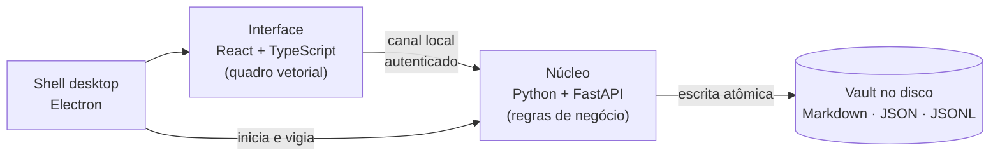

  

<h1 align="center">Washi 和紙</h1>

  <b>Mesa de trabalho digital local-first</b> — hábitos, kanban, notas e um quadro infinito
  para desenhar com mouse ou caneta, num só lugar e sem sair do seu computador.

  <a href="README.en.md">English</a> ·
  <a href="ARQUITETURA.md"><b>Arquitetura</b></a> ·
  Projeto pessoal · Windows · Código em repositório privado

---

## Por que existe

Eu queria um único espaço para acompanhar hábitos diários, organizar projetos e
rabiscar ideias — como uma mesa de verdade, onde a lista de tarefas, o quadro de
post-its e o caderno ficam lado a lado. As ferramentas que testei ou separavam
essas coisas em apps diferentes, ou guardavam meus dados na nuvem de alguém.

O Washi é a resposta: um quadro infinito onde tudo convive, com os dados em
**arquivos comuns no próprio computador** (Markdown, JSON), legíveis e meus.

## O que faz

| | |
|---|---|
| **Hábitos com meta** | grade diária de quadradinhos, sequência (🔥), progresso e previsão de conclusão — "2× por dia até 100" calcula sozinho quando você termina |
| **Marcar com a caneta** | desenhar um ✓ sobre o quadradinho marca o hábito — o traço é reconhecido localmente |
| **Kanban** | colunas com limite de trabalho em andamento, etiquetas, arrastar e soltar, teclado |
| **Notas** | Markdown com rascunho salvo automaticamente |
| **Quadro infinito** | caneta com pressão, marca-texto, borracha, formas, texto e setas que se prendem aos elementos e os acompanham |
| **Busca** | encontra qualquer coisa no vault inteiro |
| **Tema claro e escuro** | estética japonesa minimalista (*ma*, *wabi-sabi*) |

  
  &nbsp;&nbsp;
  

## Decisões de engenharia

- **Local-first de verdade.** Nada sai da máquina: sem conta, sem servidor remoto,
  sem telemetria. Os dados são pastas e arquivos legíveis (estilo Obsidian), fáceis
  de fazer backup ou versionar em Git.
- **Integridade dos dados.** Escrita atômica, registro de operações, recuperação de
  arquivo truncado após queda de energia e backups automáticos com rotação.
- **Arquitetura em duas camadas.** Regras de negócio e acesso a disco num núcleo em
  Python; a interface só desenha e envia intenções. Os dois conversam por um canal
  local autenticado, isolado da rede.
- **Desenho vetorial.** Tudo no quadro é vetor: nítido em qualquer zoom. Setas guardam
  a quem estão presas, não só coordenadas — por isso seguem o que você move.
- **Reconhecimento de gesto.** Um reconhecedor geométrico decide se o traço sobre um
  quadradinho é ✓, ✗ ou rabisco, com tolerância para grades apertadas.
- **Interface otimista.** Mover, desenhar e marcar respondem na hora; o disco confirma
  em segundo plano, com desfazer (Ctrl+Z).

➡️ **[Arquitetura em detalhe](ARQUITETURA.md)** — formato dos dados no disco, como a
escrita resiste a quedas de energia, o reconhecimento do ✓ passo a passo, segurança e
as renúncias de cada escolha.

## Qualidade

| Camada | Como é verificada |
|---|---|
| Núcleo | 111 testes automatizados, tipagem estrita, lint |
| Interface | testes unitários de geometria e câmera, checagem de tipos |
| **Uso real** | 32 verificações num navegador de verdade: desenha, apaga, conecta formas, arrasta widgets, marca hábito com a caneta e confere tela + disco |
| Empacotado | o instalador é testado abrindo o próprio `.exe`, sem ferramentas de desenvolvimento |

O teste em navegador real foi a lição mais valiosa do projeto: ele encontrou falhas de
interação (arrastos interrompidos, botões que não recebiam o clique, gesto rejeitado
pelo servidor) que passavam ilesas por todos os testes unitários.

## Tecnologias

**Python 3.12** · FastAPI · Pydantic v2 · **TypeScript** · React 18 · Vite · SVG ·
perfect-freehand · **Electron** · PyInstaller · electron-builder · pytest · mypy ·
ruff · Vitest · Playwright

## Status

Em uso pessoal. Possíveis próximos passos: sincronização opcional entre máquinas,
exportação do quadro como imagem e calibração do reconhecimento com dados reais de caneta.

O código-fonte fica em repositório privado — posso mostrar e conversar sobre ele
numa entrevista.

## Contato

**Ares** · [LinkedIn](https://www.linkedin.com/in/aresd-dev) · [aresd.dev@gmail.com](mailto:aresd.dev@gmail.com)

© 2026 Ares. Imagens e texto desta página: todos os direitos reservados.
