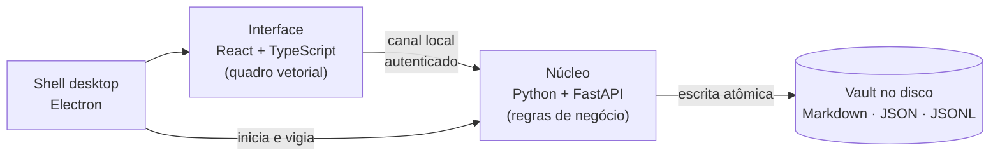

  

<h1 align="center">Washi 和紙</h1>

  <b>Mesa de trabalho digital local-first</b> — hábitos, kanban, notas e um quadro infinito
  para desenhar com mouse ou caneta, num só lugar e sem sair do seu computador.

  <a href="README.en.md">English</a> ·
  <a href="ARQUITETURA.md"><b>Arquitetura</b></a> ·
  Projeto pessoal · Windows · Código em repositório privado

---

## Por que existe

Eu queria um único espaço para acompanhar hábitos diários, organizar projetos e
rabiscar ideias — como uma mesa de verdade, onde a lista de tarefas, o quadro de
post-its e o caderno ficam lado a lado. As ferramentas que testei ou separavam
essas coisas em apps diferentes, ou guardavam meus dados na nuvem de alguém.

O Washi é a resposta: um quadro infinito onde tudo convive, com os dados em
**arquivos comuns no próprio computador** (Markdown, JSON), legíveis e meus.

## O que faz

| | |
|---|---|
| **Hábitos com meta** | semana em tabela, sequência (🔥), progresso e previsão de conclusão — "2× por dia até 100" calcula sozinho quando você termina. Metas grandes agrupam: no máximo 5 quadradinhos por dia, cada um valendo 5, 10, 15… |
| **Marcar com a caneta** | desenhar um ✓ sobre o quadradinho marca o hábito — o traço é reconhecido localmente |
| **Kanban** | rótulos de coluna coloridos, limite de trabalho em andamento, etiquetas, arrastar e soltar, teclado |
| **Timeline** | registros com início e fim numa régua de semanas ou meses; arrastar a barra muda as datas, puxar a ponta estica |
| **Notas** | página de documento com título, Markdown com rascunho salvo automaticamente e listas de tarefas (☐) |
| **Notas adesivas** | 16 cores; o texto se ajusta sozinho ao tamanho e fica claro sobre cores escuras |
| **Quadro infinito** | zoom de 2% a 2000% com grade adaptativa, minimapa, "ajustar à tela", Espaço + arrastar para mover a mesa de qualquer ponto e um atalho para voltar ao início |
| **Seleção** | arrastar no vazio seleciona o que cabe no retângulo — formas, traços e widgets — e Delete apaga tudo |
| **Lixeira** | o que sai da mesa avisa dentro do app com "Desfazer", fica 1 dia restaurável e depois some do vault sozinho |
| **Formas e conectores** | retângulo, elipse, losango e triângulo; setas presas aos elementos, em linha reta, curva ou cotovelo; barra flutuante com cor, preenchimento, duplicar e bloquear |
| **Desenho à mão** | caneta com pressão, marca-texto, borracha e laço para selecionar à mão livre; o traço é simplificado ao salvar |
| **Mapa mental** | nós que crescem com Tab/Enter, soltos na mesa junto com o resto |
| **Desfazer e refazer** | Ctrl+Z, Ctrl+Shift+Z / Ctrl+Y |
| **Busca** | encontra qualquer coisa no vault inteiro |
| **Tema escuro e claro** | escuro neutro por padrão; widgets à maneira do Miro, com o nome numa pílula acima do cartão; o vermelho fica só para estado (✓, foco, alerta) |

  
  &nbsp;&nbsp;
  

### Novidades da v0.3

Widgets no estilo do Miro (kanban com rótulos coloridos, nota como documento, semana da
tarefa como uma timeline), o widget **Timeline**, seleção por retângulo, pan com Espaço e
uma **lixeira** de 1 dia no lugar das janelas de confirmação do Windows.

### Novidades da v0.2

A versão 0.2 nasceu de um estudo de como o Miro se comporta (zoom, notas adesivas,
conectores, desenho), trazido para a escala de um app pessoal: visual escuro neutro,
barra de ferramentas lateral, quadro de 2% a 2000%, notas adesivas, novos conectores,
laço, refazer e widgets com ícone e nome — cada parte coberta por testes antes de entrar.

## Decisões de engenharia

- **Local-first de verdade.** Nada sai da máquina: sem conta, sem servidor remoto,
  sem telemetria. Os dados são pastas e arquivos legíveis (estilo Obsidian), fáceis
  de fazer backup ou versionar em Git.
- **Integridade dos dados.** Escrita atômica, registro de operações, recuperação de
  arquivo truncado após queda de energia e backups automáticos com rotação.
- **Arquitetura em duas camadas.** Regras de negócio e acesso a disco num núcleo em
  Python; a interface só desenha e envia intenções. Os dois conversam por um canal
  local autenticado, isolado da rede.
- **Desenho vetorial.** Tudo no quadro é vetor: nítido em qualquer zoom. Setas guardam
  a quem estão presas, não só coordenadas — por isso seguem o que você move.
- **Reconhecimento de gesto.** Um reconhecedor geométrico decide se o traço sobre um
  quadradinho é ✓, ✗ ou rabisco, com tolerância para grades apertadas.
- **Interface otimista.** Mover, desenhar e marcar respondem na hora; o disco confirma
  em segundo plano, com desfazer (Ctrl+Z).
- **Lixeira com prazo, sem surpresa.** Só é apagado o que entrou na lixeira com data;
  dados antigos sem data nunca são varridos. Como duplicar um widget reaproveita os dados,
  eles só somem quando nenhuma cópia (viva ou ainda na lixeira) aponta para eles.

➡️ **[Arquitetura em detalhe](ARQUITETURA.md)** — formato dos dados no disco, como a
escrita resiste a quedas de energia, o reconhecimento do ✓ passo a passo, segurança e
as renúncias de cada escolha.

## Qualidade

| Camada | Como é verificada |
|---|---|
| Núcleo | 205 testes automatizados (inclusive a limpeza da lixeira com o relógio controlado), tipagem estrita, lint |
| Interface | 163 testes unitários (geometria, câmera, grade, conectores, laço, seleção, escala da timeline, avisos), checagem de tipos |
| **Uso real** | 270 verificações num navegador de verdade: desenha, apaga, conecta formas, arrasta widgets e barras da timeline, dá zoom, seleciona, desfaz pela lixeira, marca hábito com a caneta e confere tela + disco |
| Empacotado | o instalador é testado abrindo o próprio `.exe`, sem ferramentas de desenvolvimento |

O teste em navegador real foi a lição mais valiosa do projeto: ele encontrou falhas de
interação (arrastos interrompidos, botões que não recebiam o clique, gesto rejeitado
pelo servidor) que passavam ilesas por todos os testes unitários.

## Tecnologias

**Python 3.12** · FastAPI · Pydantic v2 · **TypeScript** · React 18 · Vite · SVG ·
perfect-freehand · **Electron** · PyInstaller · electron-builder · pytest · mypy ·
ruff · Vitest · Playwright

## Status

Em uso pessoal, na versão 0.3. Próximos passos planejados: frames e modo apresentação,
anotações, imagens e emojis no quadro, sincronização opcional entre máquinas e calibração
do reconhecimento com dados reais de caneta.

O código-fonte fica em repositório privado — posso mostrar e conversar sobre ele
numa entrevista.

## Contato

**Ares** · [LinkedIn](https://www.linkedin.com/in/aresd-dev) · [aresd.dev@gmail.com](mailto:aresd.dev@gmail.com)

© 2026 Ares. Imagens e texto desta página: todos os direitos reservados.
